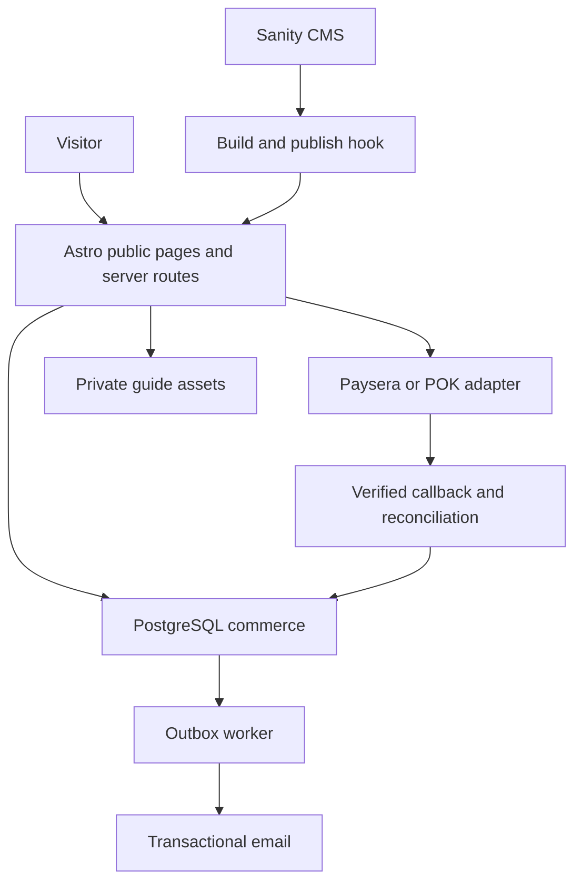

# Proposed architecture
## Decisions and alternatives
Recommend Astro with prerendered public content and server endpoints for commerce, TypeScript, Sanity for editorial CMS, managed PostgreSQL with Drizzle migrations, private S3-compatible object storage, transactional email through a selected vendor, and a scheduled database outbox worker. Use an Astro-supported runtime adapter for the chosen hosting platform; select compatible stable versions at implementation and commit the lockfile.

Next.js is reasonable if accounts, synchronized plans and interactive maps become the primary product. It adds unnecessary application complexity for this editorial MVP. Shopify is reasonable for store-first operation but custom editorial planning and a still-unselected local gateway make it a weaker default here. Do not combine Shopify, Astro and Next.js in the MVP.

## Boundaries
CMS: public destinations, journal, events, free places, guide marketing descriptions, image rights and design settings. PostgreSQL: authoritative prices, product fulfillment versions, payments, buyers, entitlements and private map coordinates. No paid coordinates in CMS public queries/build output. Storage: public optimized photos separately from private PDFs. The guide catalogue references stable product IDs; published price comes from commerce DB with rebuild/cache invalidation, while checkout always re-reads it.

Public content is built on CMS publish; protect and validate publish hooks, debounce rebuilds, report failures, preserve previous deployment on failed build. Event filtering happens at request time so expired events disappear without relying solely on a rebuild. Private routes use no-store and never enter static builds or shared caches.

## Suggested source tree
src/components/{Header,Footer,DestinationCard,GuideCard,SearchBar}.astro
src/components/hero/{HeroCollage,HeroPanorama}.astro
src/styles/{tokens,global}.css
src/pages/ (routes in 01)
src/features/content/{schemas,queries,search}.ts
src/features/trip/{storage,model}.ts
src/features/commerce/{orders,fulfillment,entitlements}.ts
src/features/payments/{contract,mock,paysera,pok,reconcile}.ts
src/features/access/{tokens,sessions,downloads}.ts
src/features/jobs/{outbox,email}.ts
src/db/{schema,migrations}/
cms/ (Sanity schemas and editor setup)
tests/{unit,integration,e2e}/

## Data model
Use UUID primary keys, UTC timestamps, foreign keys and integer minor currency units internally.
products(id, slug unique, title, active, currency, price_minor, fulfillment_version)
product_assets(product_id, version, private_object_key, kind, checksum)
orders(id, public_reference unique random, buyer_email, currency, total_minor, status, created_at)
order_items(id, order_id, product_id, title_snapshot, amount_minor, fulfillment_version)
payment_attempts(id, order_id, provider, provider_reference unique per provider, status, amount_minor, currency, idempotency_key unique)
payment_events(id, provider, dedupe_key unique per provider, payload_hash, verification_status, received_at)
entitlements(id, order_item_id unique, status, granted_at, revoked_at)
access_tokens(id, token_hash unique, buyer_email, expires_at, consumed_at)
access_sessions(id, token_hash unique, buyer_email, expires_at)
outbox_jobs(id, unique_key unique, type, payload, attempts, next_attempt_at, status)
Audit admin status changes and resend/refund actions without logging secrets or access links. MVP supports one product per checkout, quantity one; purchases still use order_items to support later bundles. Bundle entitlements require an explicit future design, not accidental duplicate charging.

## Access and deployment
Email is the purchase identity, optional account later. Access link expires after 15 minutes and is single use; private session 7 days; download URLs 60 seconds. Requesting a new link is rate limited. Initial verified checkout session may grant immediate access; otherwise email redemption is required. Store hashes, rotate/revoke tokens, mask logs. Signed download URL sharing and downloaded PDF copying cannot be fully prevented.

Development uses mock provider, local fixtures and test DB; staging uses isolated test credentials, private PDFs and email test inbox; production uses approved credentials. Secrets stay server-side. Document DB backup schedule, restore procedure, object versioning, alerting for payment mismatch and failed fulfillment. No card data stored. Dashboard protected by a maintained auth solution with owner role; do not handroll admin passwords.
